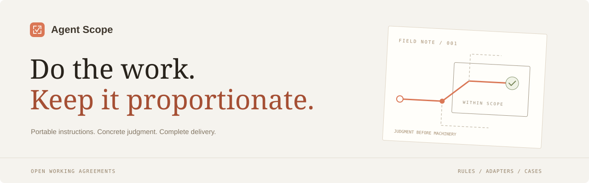

# Agent Scope



**Do the work. Keep it proportionate.**

[Website](https://rikfish163-rgb.github.io/agent-scope/) · [Full rules](RULES.md) · [Core rules](rules/core.md) · [中文](README.md)

Portable working instructions for coding agents, with an open catalogue of bad and positive cases. The full prompt combines scope control, engineering conventions, purposeful verification, and final-result writing. Its scope principles are adapted from [HERO — Anti-OverDefense](https://github.com/wanshuiyin/HERO-Anti-OverDefense), under MIT.

Report every genuine issue, including uncommon inputs reachable through supported usage. Bound the remedy, not discovery. Required security, compatibility, migration, and review work stays required. Prefer concrete judgment and continued delivery over speculative scaffolding or repeated audits.

## Install

Run from the target project directory. Requires Git and Python 3.9+, with no Python dependencies.

```bash
git clone https://github.com/rikfish163-rgb/agent-scope.git "$HOME/.local/share/agent-scope"
python3 "$HOME/.local/share/agent-scope/install.py" --agent codex --project .
```

Available adapters: `codex`, `claude`, `cursor`, `copilot`, `gemini`, `opencode`. Existing project text is preserved; reinstalling updates the managed block. Add `--profile core` for the nine core principles, or `--remove` to uninstall the block. Use `--dry-run` to preview the destination. Supported hosts also accept `--global`; custom hosts accept `--agent generic --target /path/to/instructions.md`.

On Windows PowerShell:

```powershell
git clone https://github.com/rikfish163-rgb/agent-scope.git "$env:LOCALAPPDATA\agent-scope"
py -3 "$env:LOCALAPPDATA\agent-scope\install.py" --agent codex --project .
```

The optional Gemini CLI extension loads `RULES.md` directly:

```bash
gemini extensions install https://github.com/rikfish163-rgb/agent-scope
```

Choose file installation or the extension, not both. [Platform sources, update/remove commands, and loading details](hosts.md).

## Cases and contributions

[Submit a bad case](https://github.com/rikfish163-rgb/agent-scope/issues/new?template=bad-case.yml) or [submit a positive case](https://github.com/rikfish163-rgb/agent-scope/issues/new?template=positive-case.yml). Include the task, actual behavior, relevant evidence, consequences, and an appropriate next action. Positive cases include justified verification and security work.

The eight seed cases are explicitly illustrative, not measured model results. Accepted real reports are marked `observed` and retain their evidence. The case catalogue is not installed into agent context. See [CONTRIBUTING.md](CONTRIBUTING.md).

## Development

```bash
python3 -m unittest discover -s tests
node --check site/app.js
python3 scripts/build_site.py
python3 -m http.server 8000 --directory docs
```

The site is buildless HTML/CSS/JS with a standard-library Python content build. GitHub Pages serves `main:/docs`.

## Limitations

Instructions guide behavior; they do not guarantee compliance. Host limits, excluded sources, compaction, and more specific project rules can affect loading or behavior. Tests cover installer file operations and site content; compatibility documentation is not a claim of end-to-end testing on every client or measured model improvement.

MIT. See [LICENSE](LICENSE) and [attribution](THIRD_PARTY_NOTICES.md).
